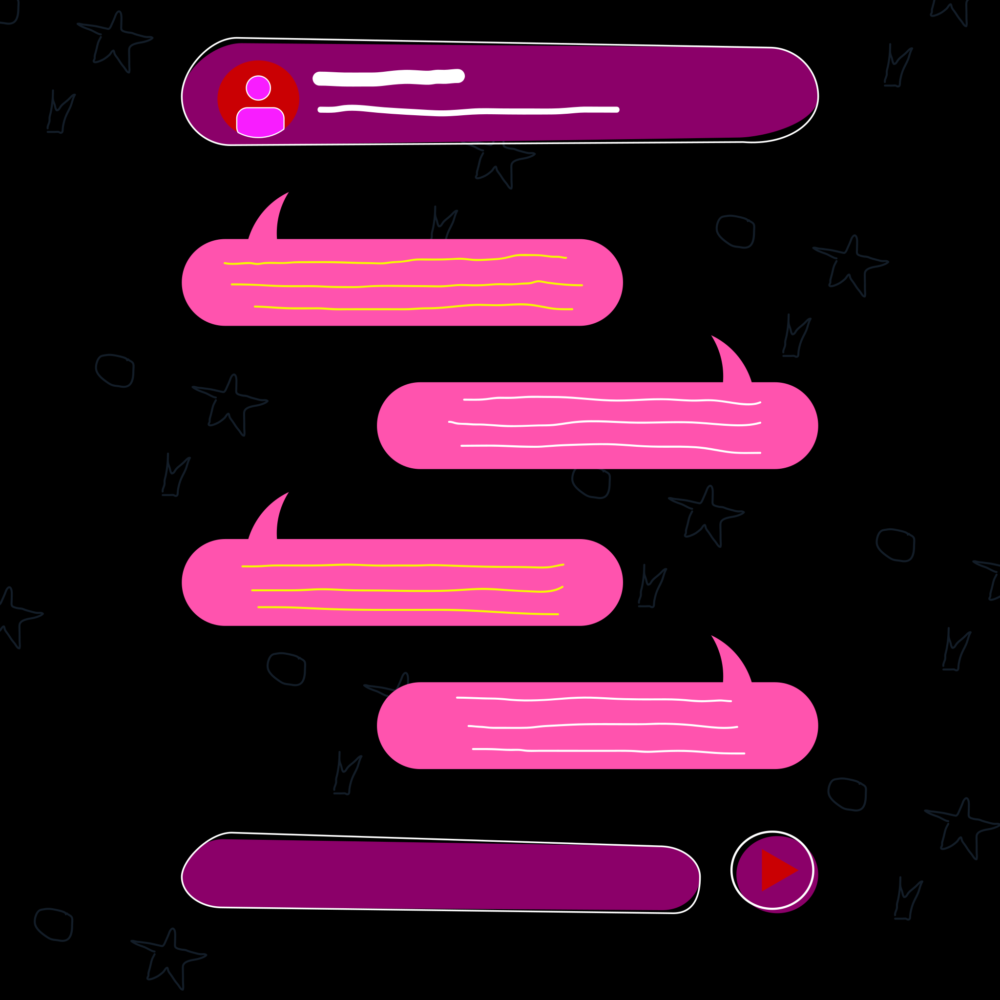

<p align="center">
  
</p>

<h1 align="center">ChatViz</h1>

<p align="center">
  A privacy-first viewer for your Instagram, Snapchat and WhatsApp chat exports.<br>
  Everything runs in your browser. Files are never uploaded.
</p>

## Features

- **Instagram:** `message_*.json`. Fixes Instagram's broken emoji/accent encoding, merges multi-file threads, and splits different conversations into separate chats.
- **Snapchat:** `chat_history.json`. Every conversation is imported, not just the largest.
- **WhatsApp:** the "Export chat" `.txt`, or the `.zip` with media. Photos, videos, voice notes and stickers are shown inline. Android and iOS formats are both supported, and day/month order is detected automatically. Zips are read straight from the file one entry at a time (Zip64 included), so multi-GB exports don't have to fit in memory.
- **Encrypted library:** imported chats are saved in this browser (IndexedDB), encrypted with your passphrase. They survive reloads and are unlocked once per visit. You can delete chats one at a time, clear everything, or use **View without saving** to keep a chat only until the tab closes.
- **Re-importing:** when a new export looks like a chat you already saved (same people, or same group name), ChatViz asks whether to **Replace** it (the default, keeps your "who are you" choice) or **Save as new** next to it.
- **"Who are you?"** When the export doesn't say which participant you are, ChatViz asks. You can change it at any time from the header.
- **Search** (Ctrl/Cmd+F) with highlighted matches, plus **jump to date**.
- **Themes:** pick a background (Dark, Super dark for OLED screens, Midnight, Mocha, Light) and an accent colour separately from the palette button. Every combination meets WCAG AA text contrast. The choice is remembered in this browser.
- **Works on phones:** touch-sized controls, no sideways scrolling down to 320px wide, safe-area aware (notches, home indicator), no zoom-on-focus on iOS, and pull-to-refresh is disabled so a stray swipe can't lock your vault.
- A virtualized list handles 100k+ messages, and parsing happens in a Web Worker.

## Privacy model

- Parsing, unzipping and storage all happen locally: Web Worker, IndexedDB, object URLs.
- Production builds ship a Content-Security-Policy with `connect-src 'none'`, which blocks every `fetch`, XHR, WebSocket and beacon. It's sent both as a `<meta>` tag and, on the hosted site, as an HTTP header that also forbids framing (`frame-ancestors 'none'`). The parse worker is bundled inline and runs from a `blob:` URL, so the same policy applies inside it. (A worker loaded from its own `.js` file takes its policy from that file's HTTP headers instead, and a `<meta>` CSP wouldn't cover it.) CSP can't stop the page from navigating away, which is why links ask first.
- No third-party fonts, analytics or CDNs. Inter is bundled.
- Shared links inside chats ask for confirmation before opening, and are sent without a referrer.
- **Saved chats are encrypted.** Your passphrase is stretched with PBKDF2-SHA256 (600,000 iterations) into an AES-256-GCM key, which encrypts chat names, participants, messages and media, and an HMAC key, which makes database keys opaque. Nothing readable is written to disk.
- The key exists only in memory. Reloading or closing the tab, or pressing **Lock**, forgets it.
- **The passphrase can't be recovered.** If you forget it, the only option is "Forgot passphrase? Erase saved chats".
- Chats saved unencrypted by an earlier version are encrypted the first time you set a passphrase, and the plaintext copies are deleted. The browser may keep deleted IndexedDB data on disk until it compacts its files, so if that matters, clear this site's data in the browser settings after upgrading.

## Known limitations

- **Replies:** Instagram and Snapchat data exports don't record which message a reply was answering, so replies show as normal messages. Instagram's "Reacted 😂 to your message" / "Liked a message" notifications are shown as compact reaction events, because the export doesn't say which message they refer to either.
- There's no way to change the passphrase yet. To change it, erase and re-import.
- Re-import matching is a best guess (platform plus the same people, or the same title). It always asks, and "Save as new" is one tap away.
- Chats viewed with **View without saving** read media straight from the file you picked. If you move or delete that file while the chat is open, its images stop loading.

## Exporting your chats

| App | Steps |
| --- | --- |
| Instagram | Settings → Your activity → Download your information → Messages, **JSON** format → upload `message_*.json` |
| Snapchat | accounts.snapchat.com → My Data → JSON, include Chat History → upload `chat_history.json` |
| WhatsApp | Open the chat → ⋮ / contact name → Export chat → *Include media* → upload the `.zip` (or the `.txt`) |

## Development

```sh
npm install
npm run dev       # dev server (no CSP, so HMR works)
npm test          # parser, zip, crypto, encrypted-storage and library tests (vitest)
npm run lint
npm run build && npm run preview   # production build with CSP
```

Sample files for manual testing are in `public/` (`sample_chat.json`, `sample_snapchat.json`, `sample_whatsapp.txt`).

### Deployment

https://chatviz.nicx.dev is an assets-only Cloudflare Worker (`wrangler.jsonc`): Cloudflare serves `dist/` and no server code runs. The build also writes `dist/_headers` (CSP and other security headers, long caching for `assets/`), generated in `vite.config.js` from the same CSP as the meta tag.

GitHub Actions (`.github/workflows/ci.yml`) lints, tests and builds every push and PR, and deploys pushes to `main`. It needs two repository secrets, `CLOUDFLARE_API_TOKEN` and `CLOUDFLARE_ACCOUNT_ID`.

Dependabot (`.github/dependabot.yml`) opens weekly update PRs for npm packages and GitHub Actions, once a release is a week old. Merging one deploys it.

```sh
npm run build && npx wrangler dev   # serve dist/ with the production headers
npm run deploy                      # manual deploy (after `npx wrangler login`)
npx wrangler rollback               # back to the previous version
```

### Layout

```
src/parsers/     instagram.js, snapchat.js, whatsapp.js, index.js (detection), common.js
                 zip.js -- random-access zip reader (reads entries from the File on demand)
src/storage/     crypto.js -- WebCrypto (PBKDF2, AES-GCM, HMAC)
                 db.js -- encrypted IndexedDB vault (chats, messages, media)
src/workers/     parseWorker.js -- off-main-thread parsing, bundled inline
src/utils/       layout.js -- grouping, date headers, stats
                 library.js -- matching re-imports to saved chats
src/theme.js     background theme + accent colour (tokens live in index.css)
src/components/  ChatScreen, ChatView, ChatToolbar, MessageBubble, StatsBar,
                 DropZone (landing screen), Doodles (its illustrations),
                 VaultPanel, ReimportPanel, Library, ThemePicker
public/          theme-init.js -- applies the saved theme before first paint
                 favicon.svg/.ico, apple-touch-icon.png -- from logo.svg
```

Colours are CSS tokens: each background theme is a `[data-theme]` block in `src/index.css` and each accent a `[data-accent]` block. To add a theme, add a block, add it to `THEMES` in `src/theme.js`, and check its text contrast (secondary and tertiary text at least 4.5:1 on every surface).
